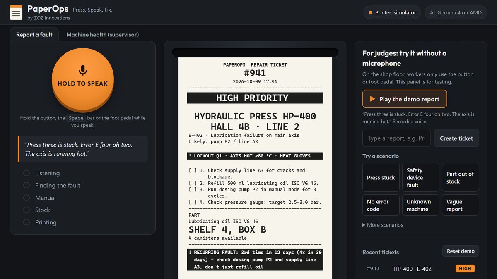

# PaperOps – The Glove-Proof Industrial Dispatcher

> Press. Speak. Fix.

A maintenance technician holds one button (or steps on a foot pedal) and describes a machine fault by voice. PaperOps understands the report, looks up the machine manual, checks spare-part stock and prints a short repair ticket on a thermal printer: **safety step first**, the right part and its exact shelf location. No screen to read, no typing – it works with dirty gloves. It also spots faults that keep coming back and points to the root cause.

**AI: Gemma 4 on AMD GPUs via AMD Token Factory.** Google's open model `Gemma-4-31B-IT` turns every report into a structured fault; it runs on AMD GPUs through the [AMD Token Factory](https://notebooks.amd.com/tokenfactory).

Built for the **AMD Developer Hackathon: ACT III** – Track 1 *Intelligent Industry* by [ZOZ Innovations](https://www.zozinnovations.com).



## Live demo

- App: TODO (hosted URL)
- Video: TODO

## Who it's for

- **Maintenance technicians** on the shop floor: report a fault by voice in seconds and get a ticket they can take to the machine – the safety step, the steps to tick off, and where the part is.
- **Shift leads and maintenance planners**: see which machines keep failing, which faults are accelerating and which parts must be reordered (*Machine health* tab).

## Impact

Measured on the 15 test cases in [`data/test_transcripts.json`](data/test_transcripts.json) (`python scripts/bench_cases.py`):

| | Result |
|---|---|
| Correct tickets | **15 / 15** (machine, fault code, priority, part, location, safety) |
| Safety step first | **100 %** of printed tickets – one black safety block before any repair step, taken from the manual, never from the model |
| Part location | **every** ticket that needs a part shows its shelf location (10 / 10), with an approved alternative when the original is out of stock |
| Unclear reports | nothing is printed for nonsense or an unknown machine – the screen asks back ("Which machine?") instead of guessing |
| Time from voice to ticket | **typically under 10 s** (speech-to-text ~0.5 s + Gemma typically 2–5 s), slower when the Token Factory is busy |

## Two views

| View | URL | What you see |
|---|---|---|
| **Shop floor** | `/?mode=floor` | Only the big **HOLD TO SPEAK** button (mouse, touch, space bar or USB foot pedal), the progress and the printed ticket. This is the real product – and the view used in the video. |
| **Demo for judges** (default) | `/` | The same worker area, plus a clearly separated panel **"For judges: try it without a microphone"**: *Play the demo report* (a recorded voice report), a text field and *Try a scenario* (6 main and 9 more test scenarios). Tabs: *Report a fault* and *Machine health (supervisor)*. *Reset demo* clears the recent tickets for a clean run. |

**How judges test:** open the demo URL – no login. Click *Play the demo report*, or pick a scenario such as *Safety device fault* or *Part out of stock*. To try your own voice, hold the button (or the space bar) and speak; the browser asks for microphone access (HTTPS required).

## How it works

1. **Voice in** – push-to-talk in the browser: hold the button, the space bar or a USB foot pedal.
2. **Speech-to-text on our server** – **faster-whisper** (`base.en`, int8, CPU, ~0.5 s), primed with the plant's machine names, aliases and error codes. Audio never goes to a third-party cloud.
3. **Gemma 4 on AMD GPUs via AMD Token Factory** – **one** call to **Gemma-4-31B-IT** turns the transcript into `{machine_id, error_code, cause, part, symptoms, evidence}`. The hackathon organizers confirmed officially that running the AI on the Token Factory "perfectly satisfies" the requirement that a substantial part of the workload runs on AMD.
4. **Lookups in code** – machine manual, spare-part stock and shelf location, approved alternatives, 30-day fault history. Repair steps always come from the manual, so the safety step is always first and the model cannot invent parts.
5. **Evidence check** – Gemma quotes the words that name the machine and the fault; the code checks (fuzzily, with spoken numbers normalised – "E four oh two" = E-402) that they were really said. If not – e.g. a misheard machine name – the ticket still prints with the safety step, under a bold **UNCONFIRMED – verify machine on site** banner and "Did you mean …?".
6. **Ask back instead of wasting paper** – nonsense, small talk or "press three" without a fault print nothing; the screen asks "Which machine?" or "What is wrong with HP-400?" ("Print anyway" is one click away).
7. **Ticket out** – ESC/POS commands for an 80 mm thermal printer, black and white only: big ticket number, priority by shape (black bar for HIGH, double black bar for CRITICAL), machine and location in large print, one black safety block, steps with tick boxes, part and shelf, QR code. Without a printer, the on-screen simulator renders the very same bytes ("Show printer commands" lists them).
8. **Recurring faults** – e.g. E-402 on HP-400: "3rd time in 12 days (4× in 30 days) – check dosing pump P2 and supply line A3, don't just refill oil".
9. **Machine health (supervisor tab)** – per machine: reports and downtime in the last 30 days, the repeated fault and a *trend-based estimate*: a fault that comes back faster ("next E-402 expected in ~4 days", intervals 7 → 4 days), a part for a recurring fault that is out of stock and not reordered, parts below minimum stock. Counted on a fixed demo clock (`DEMO_NOW`, default: the latest history entry), so the demo data does not age out.

**Resilience:** the app checks `GET /v1/models` at startup and validates every answer. Gemma and MiMo-V2.6-Flash start **at the same time** and the first valid answer wins – so the latency is that of the faster model, and Gemma answers in most cases. If neither has answered after 6 s, GLM-5.3-Flash and then DeepSeek-V4.1-Flash join. Only if no model answered within `LLM_BUDGET` (**16 s**) does a recorded real run from `replay/` step in – clearly labelled "Replay of a recorded live run" with its original timing. `REPLAY_MODE=always` gives a fully offline demo, `off` disables replay.

## Install and run

### Prerequisites

- An **AMD Token Factory API key** ([notebooks.amd.com/tokenfactory](https://notebooks.amd.com/tokenfactory)) for `RADEON_API_KEY`
- Either **Docker** (recommended) or **Python 3.12**
- About **2 GB RAM** for the app (the Whisper model stays in memory)
- Optional: an ESC/POS 80 mm thermal printer on your network

### 1. Get the code and configure

```bash
git clone https://github.com/zozinnovations/paperops.git
cd paperops
cp .env.example .env
```

Open `.env` and set `RADEON_API_KEY`. All other settings have working defaults (see [Configuration](#configuration)).

### 2a. Run with Docker (recommended)

```bash
docker compose up --build
```

Open http://localhost:8000 – or http://localhost:8000/?mode=floor for the shop-floor view. The build bakes the Whisper model into the image (~1.8 GB), so the container never downloads anything at runtime; the first build takes a few minutes. Another port on your machine: `HOST_PORT=8002` in `.env`.

### 2b. Run without Docker

```bash
python -m venv .venv
. .venv/bin/activate              # Windows: .venv\Scripts\activate
pip install -r requirements.txt
uvicorn app.main:app --port 8000
```

On the first start faster-whisper downloads the `base.en` model (~150 MB) once.

### 3. Check it works

```bash
python scripts/bench_cases.py     # all 15 test cases against the live models
```

`localhost` counts as a secure origin, so the microphone works locally without HTTPS.

### Connect a thermal printer (optional)

Any ESC/POS 80 mm printer on your network (raw TCP, usually port 9100):

- **Printer settings dialog** – set `ALLOW_PRINTER_SETUP=1` in `.env` (local installs only), restart once, then use *Printer settings* in the header: IP address or host name, port, *Test print* and status. Changes apply immediately, no restart. Only local-network addresses are accepted.
- **Or via `.env`** – `PRINTER_HOST=192.168.1.50` and `PRINTER_PORT=9100`.

The header shows "Printer: connected"; without a printer the ticket appears in the on-screen simulator. On the hosted demo `ALLOW_PRINTER_SETUP` stays `0`, so nobody can point the server at arbitrary network targets.

## Hosting (demo URL for the judges)

PaperOps needs a long-running process with **2 GB RAM** and **HTTPS** (browsers only allow the microphone on HTTPS). Serverless platforms such as Vercel do not fit. The same Docker image runs on:

| Platform | Config in this repo | Steps |
|---|---|---|
| **Railway** (simplest) | `railway.json` | New project → deploy from the GitHub repo → add variable `RADEON_API_KEY` → Settings → Networking → generate domain (HTTPS included) |
| **Fly.io** | `fly.toml` (2 GB, always on, Frankfurt) | `fly launch --copy-config --no-deploy` → `fly secrets set RADEON_API_KEY=...` → `fly deploy` |
| **Render** | `render.yaml` (plan *standard*, 2 GB) | New → Blueprint → select the repo → enter `RADEON_API_KEY` |

On every platform: set the API key only as a secret, set `PUBLIC_URL` to the HTTPS address (QR code and link preview), keep `ALLOW_PRINTER_SETUP=0`, and keep one instance always running so judges never hit a cold start. The platform passes `PORT`; the image listens on it and serves `/api/health` for health checks.

**Own server with a domain:** set `DOMAIN` and `PUBLIC_URL` in `.env` and start the bundled Caddy proxy, which gets a certificate automatically: `docker compose --profile https up -d --build`.

## Configuration

| Variable | Default | Meaning |
|---|---|---|
| `RADEON_API_KEY` | – | AMD Token Factory key (required) |
| `PRIMARY_MODEL` / `FALLBACK_MODELS` | `Gemma-4-31B-IT` / `MiMo-V2.6-Flash,GLM-5.3-Flash,DeepSeek-V4.1-Flash` | model chain; the first two race |
| `WHISPER_MODEL` | `base.en` | speech-to-text model (`small.en`: ~1.5 s, same accuracy on our samples) |
| `REPLAY_MODE` | `fallback` | `off`, `fallback` (only if no model answered within `LLM_BUDGET`), `always` (offline demo) |
| `LLM_BUDGET` / `LLM_MAX_TOTAL` | `16` / `30` s | time for the live models with / without a recorded run in reserve |
| `DEMO_NOW` | latest history entry | demo clock for "last 30 days" and recurring faults |
| `PRINTER_HOST` / `PRINTER_PORT` | – / `9100` | thermal printer; empty = on-screen simulator |
| `ALLOW_PRINTER_SETUP` | `0` | `1` enables the printer settings dialog (local installs only) |
| `DEMO_MODE` | `0` | `1` prints "(replay)" on the receipt when a recorded run is used |
| `PUBLIC_URL` | – | HTTPS address of the hosted app |
| `HOST_PORT` | `8000` | port on your machine for `docker compose` |
| `RATE_LIMIT_PER_MIN` | `10` | requests per minute per client IP |

## Project layout

```
app/        FastAPI backend: main.py (API, pages), pipeline.py (Gemma call + lookups), llm.py (model race,
            fallback, replay), evidence.py, health.py, stt.py (faster-whisper), escpos.py, printer.py, static/ UI
data/       fictional demo data: machine manuals, ERP inventory, 30-day ticket history, 15 test cases
samples/    spoken versions of test cases T01-T12 (scenario buttons)
replay/     recorded real Gemma answers for the offline / slow-API fallback
scripts/    bench_cases.py (all cases), test_audio.py (voice end-to-end), refresh_replay.py,
            make_icons.py, make_og_image.py
```

## Demo data

All data in `data/` is fictional: machine manuals, ERP inventory, test transcripts and a 30-day ticket history.

## License

MIT – see [LICENSE](LICENSE).
